  <picture>
    <source media="(prefers-color-scheme: dark)" srcset="assets/hero-dark.svg">
    <source media="(prefers-color-scheme: light)" srcset="assets/hero-light.svg">
    
  </picture>

## Tech Stack

<table>
  <tr>
    <th align="left">Frontend</th>
    <td width="2000">
      
      
      
      
      
      
      
      
    </td>
  </tr>
  <tr>
    <th align="left">Mobile</th>
    <td width="2000">
      
      
      
      
      
    </td>
  </tr>
  <tr>
    <th align="left">Backend 공부하는 중</th>
    <td width="2000">
      
      
      
      
    </td>
  </tr>
  <tr>
    <th align="left">Tools</th>
    <td width="2000">
      
      
      
      
    </td>
  </tr>
</table>

## Contact

<table>
  <tr>
    <th align="left">SNS</th>
    <td width="2000">
      
      
    </td>
  </tr>
</table>

## Projects

<table>
  <tr>
    <td width="2000">

### PicTree

**사진 · 위치 · 동선 · 글쓰기를 하나로 잇는 여행 기록 서비스** 
2026.07 – 2026.08 · 프론트엔드 4인 팀 · 타임라인 · 마이페이지 · 공용 컴포넌트 담당

  
  
  
  
  

- **타임라인** — 사진 그리드 피드와 검색 · 정렬, 기록 생성 · 수정 · 삭제까지 API 연동
- **마이페이지** — 구독 관리 · 결제 내역, 여행 캘린더(잔디), 즐겨찾기, 내 정보 · 회원 탈퇴
- **근처 나무 알림** — 위치 감시와 `maxWait` 디바운스 훅으로 알림을 띄우고 PWA 푸시 구독까지 연결
- **공용 컴포넌트** — TabBar · Modal · Toast · EmptyState 로 화면마다 다르던 빈 화면과 오류 표현을 통일
- **서버 상태** — 쿼리 키 팩토리와 도메인별 캐시 수명, 목데이터 대신 실패 사유를 알려 주는 에러 처리

`React 19` `TypeScript` `Vite` `Tailwind CSS` `TanStack Query` `Zustand` `Kakao Maps`

[저장소](https://github.com/PicTree-UMC/PicTree-Frontend) · [Live Demo](https://picturetree.netlify.app)

</td>
  </tr>
</table>

<table>
  <tr>
    <td width="2000">

### PicTree App · Web

**웹에서 시작한 PicTree 를 iOS · Android 앱으로** 
2026.09 – 진행 중 · 비공개 저장소 · 프론트엔드

- **앱으로 옮기기** — 웹 화면을 Expo + React Native 로 옮기고, 새 디자인 시안에 맞춰 지도 · 기록 · 마이 · 설정 화면을 다시 구성
- **서버 연결** — 이메일 로그인 · 회원가입 · 비밀번호 찾기, 내 정보 · 알림 설정 · 회원 탈퇴를 API 에 연결하고 푸시 토큰 등록 · 딥링크까지
- **화면 다듬기** — 작은 화면(360×640), 시스템 글꼴 200%, 키보드가 올라온 상태까지 확인하며 고친 PR 120여 건
- **웹** — 관리자 페이지(로그인 · 주문 관리)와 소개 · 정책 화면, 디자인 시스템 토큰 · 공통 컴포넌트 적용

`React Native` `Expo` `Expo Router` `TypeScript` `TanStack Query` `Zustand` `Reanimated`

</td>
  </tr>
</table>

<table>
  <tr>
    <td width="2000">

### RouteAlarm

**도착 시간에서 거꾸로 계산하는 스마트 출발 알람** 
2026.10 – 진행 중 · Android

  
  
  
  
  

- **알람 계산** — 목표 도착 − 이동 − 여유 − 준비 = 기상 시각. 계산 · 조정 로직은 단위 테스트로 검증
- **교통 재확인** — WorkManager 로 출발 전에 다시 확인하고, 지연되면 알람을 앞당기거나 변경을 추천
- **Offline First** — 네트워크가 끊겨도 Room 캐시의 마지막 계산값으로 알람 유지, 재부팅 뒤에도 복구
- **Compose 디자인 시스템** — 노선도형 홈, 아이폰식 휠 시간 입력, 컬러 테마 3종

`Kotlin` `Jetpack Compose` `MVVM` `Hilt` `Room` `DataStore` `WorkManager`

[저장소](https://github.com/acylelli/Mobile-Programming)

</td>
  </tr>
</table>

<table>
  <tr>
    <td width="2000">

### CodeRefactor

**코드 의존성 시각화 & AI 리팩토링 가이드** 
2026.09 – 2026.12 · 캡스톤 디자인 4인 팀 · 프론트엔드 담당

- 대규모 코드의 의존 관계를 브라우저에서 그래프로 보여 주고, 결합도 지표로 위험한 곳을 짚어 주는 웹 도구
- Cytoscape.js 인터랙티브 캔버스 렌더러와 노드 스타일링, 다크 테마 디자인 시스템, 뷰 제어 컨트롤러

`JavaScript` `Cytoscape.js` `Node.js` `Tree-sitter`

[저장소](https://github.com/Jiin5906/CodeDiagram)

</td>
  </tr>
</table>

<table>
  <tr>
    <td width="2000">

### UMCine

**매주 한 겹씩 쌓아 가는 풀스택 영화 서비스** 
2026.09 – 진행 중 · UMC 11기 Web 스터디

- **Frontend** — TanStack Router 라우팅, TanStack Query 로 목록 · 검색 · 상세 요청 관리, Zustand 북마크
- **Backend** — NestJS + TypeORM 회원 · 평점 API, JWT 로그인과 Guard, 전역 예외 필터
- 로그인 응답 시간으로 가입 여부가 드러나지 않게 막는 것처럼, 미션 밖의 빈틈까지 챙기기

`React` `TanStack Router` `TanStack Query` `NestJS` `TypeORM` `MySQL`

[저장소](https://github.com/HSU-Makeus-Challenge-11th/Web_C)

</td>
  </tr>
</table>

**그 밖에**

- [날씨 코디 추천](https://github.com/jaewoni314/weather-recommendation-app) — 날씨에 맞춰 옷차림을 추천하는 안드로이드 앱. 시간별 · 주간 예보와 홈 화면 위젯 · `Kotlin` `Jetpack Compose` `Retrofit`
- [CineSearch](https://github.com/jaewoni314/umc-final-vercel) — TMDB 영화 검색 · 필터 앱, Vercel 배포 · `React` `TypeScript` · [Demo](https://umc-final-vercel.vercel.app)
- [OmokGame](https://github.com/jaewoni314/OmokGame) — AI 대전(난이도 3단계) · 리플레이 · 업적이 있는 오목 · `Java` `Swing`

## Activity

  <picture>
    <source media="(prefers-color-scheme: dark)" srcset="assets/summary-dark.svg">
    <source media="(prefers-color-scheme: light)" srcset="assets/summary-light.svg">
    
  </picture>
  <picture>
    <source media="(prefers-color-scheme: dark)" srcset="assets/languages-dark.svg">
    <source media="(prefers-color-scheme: light)" srcset="assets/languages-light.svg">
    
  </picture>
  <picture>
    <source media="(prefers-color-scheme: dark)" srcset="assets/projects-dark.svg">
    <source media="(prefers-color-scheme: light)" srcset="assets/projects-light.svg">
    
  </picture>

## Commit Log

작업하면서 남긴 커밋 몇 줄입니다.

- [`c4f3015`](https://github.com/PicTree-UMC/PicTree-Frontend/commit/c4f3015acc2c7654c15a1e729b80d1c464d06b07) fix: 날짜만 있는 값이 시간대 때문에 하루 밀리던 것
- [`fde8f0d`](https://github.com/PicTree-UMC/PicTree-Frontend/commit/fde8f0da4e1d6eba47668f3d2d4b1ac64413cae1) fix: API 실패를 목데이터로 덮지 않고 사유를 알리도록 통일
- [`4e49908`](https://github.com/PicTree-UMC/PicTree-Frontend/commit/4e499085ab6e16a2b7c9563ee6cacaf418e40b14) fix: 홈 지도가 장소 목록의 로딩·실패를 말하지 않던 것
- [`272c25e`](https://github.com/PicTree-UMC/PicTree-Frontend/commit/272c25e643b702dbc8532bd04d0bbfddc305fca9) feat: 빈 화면 공용 컴포넌트 EmptyState 추가
- [`751db3e`](https://github.com/PicTree-UMC/PicTree-Frontend/commit/751db3eb4bad926bad6faa1446bd5a1539f5a6dc) refactor: 캐시 수명을 도메인별로 차등한다
- [`aa4205e`](https://github.com/HSU-Makeus-Challenge-11th/Web_C/commit/aa4205ed2ac059099473c20eeaa8e69f5f1ada2f) fix: Week7 로그인 응답 시간으로 가입 여부가 드러나지 않게 수정

 

  배너와 활동 카드는 이 저장소의 <a href="scripts/build-cards.mjs">스크립트</a>가 GitHub Actions 로 매일 새로 그립니다.

